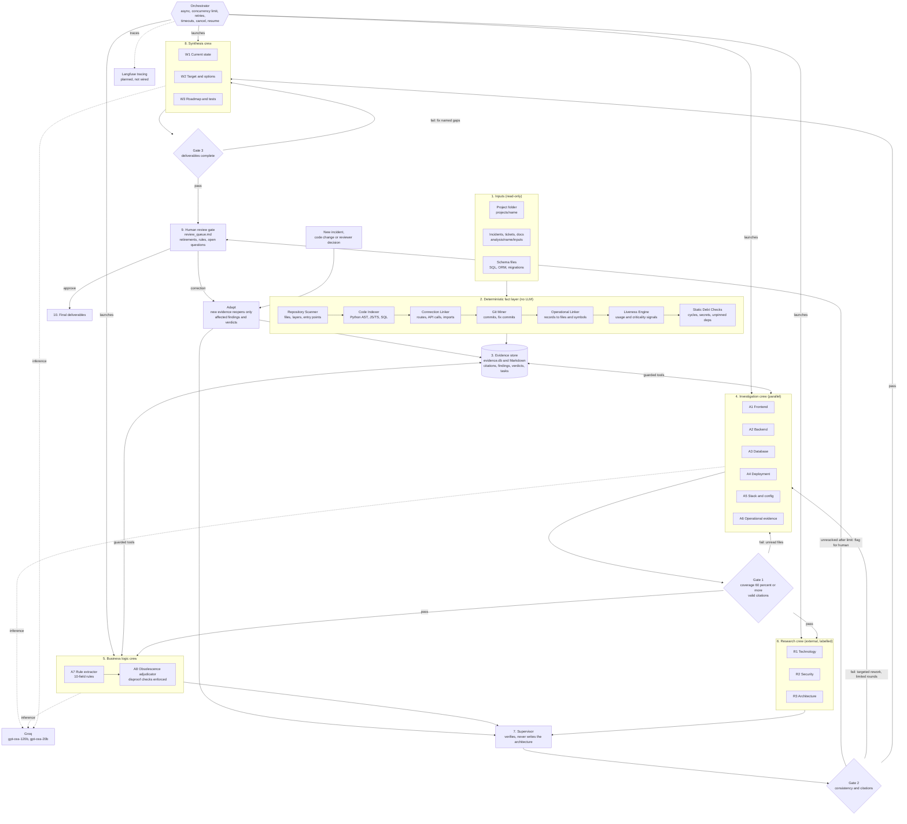
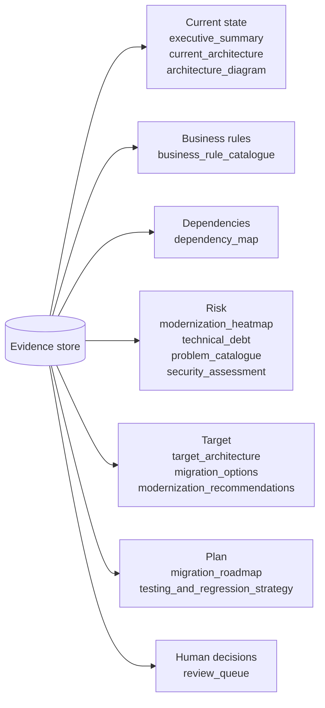
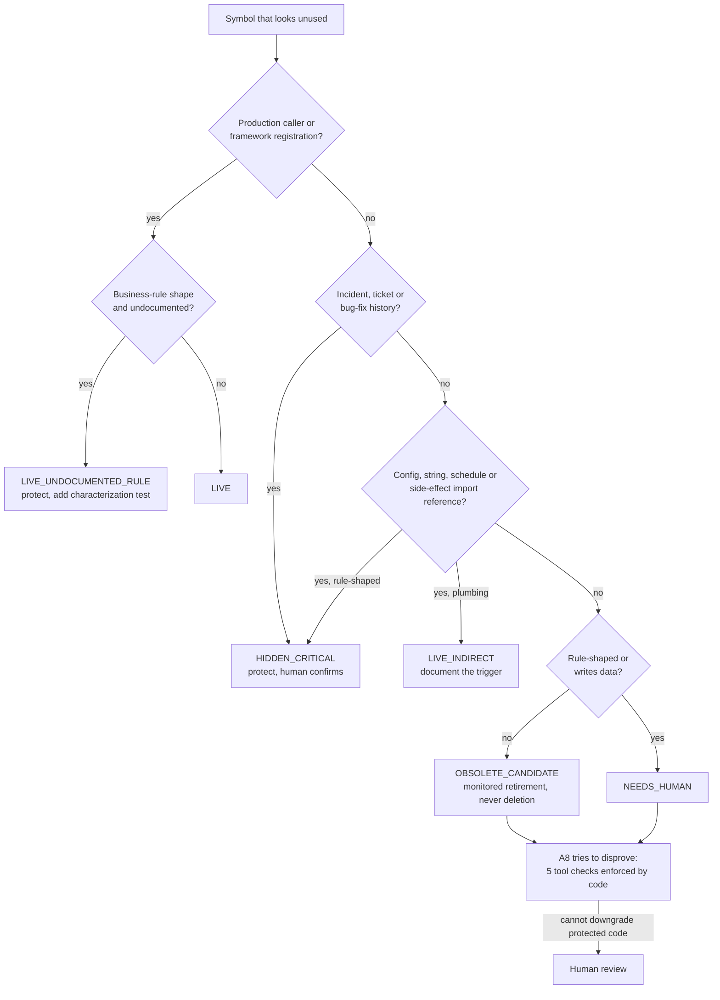

# Architecture Diagram: Autonomous Legacy Modernization Agent

This replaces the earlier diagram. The Mermaid source below has not been rendered in a viewer, so check it once in your Markdown preview.

## Problems found in the original diagram

| # | Problem | Why it matters | Fixed here |
|---|---|---|---|
| 1 | All three gates sit in one box on the left, with arrows crossing the crews | The order is unreadable: Gate 1 should sit between investigation and business logic, Gate 2 after verification, Gate 3 after synthesis | Each gate sits where it happens in the flow |
| 2 | A floating `Pass` label with no source and target | A dangling edge; it reads as a mistake | Every edge has a source and a target |
| 3 | No failure paths | Gates look like they can only pass. The rework loops are the reliability story | Fail edges go back to the crew that must redo work |
| 4 | No loop from the human gate back into the system | The challenge asks how the solution adapts when evidence changes | `Adapt` node reopens only the affected findings |
| 5 | The fact layer lists only Scanner, Liveness, Indexer and Linker | Git Miner, Operational Linker and Static Debt Checks exist and feed the liveness verdicts | All seven components shown in order |
| 6 | No orchestrator | Nothing shows who schedules tasks, retries, enforces timeouts and resumes runs | `Orchestrator` node added |
| 7 | Research and Synthesis crews have no inbound or outbound edges | They look disconnected from the flow | Wired in the correct order |
| 8 | Deliverables list is partial (6 files) | The brief lists nine expected outcomes | All deliverable groups shown |
| 9 | The inference engine named two Llama models | Both return 404 on the configured Groq account, so no agent could run | Updated to `gpt-oss-120b` and `gpt-oss-20b`, which the account can use |
| 10 | Langfuse drawn as if it is connected | Tracing is not wired in the code yet | Marked as planned, dashed |

## System flow

## Deliverables

## How one code symbol is judged (the critical requirement)

Age, old technology and low commit activity carry no weight in this decision.
