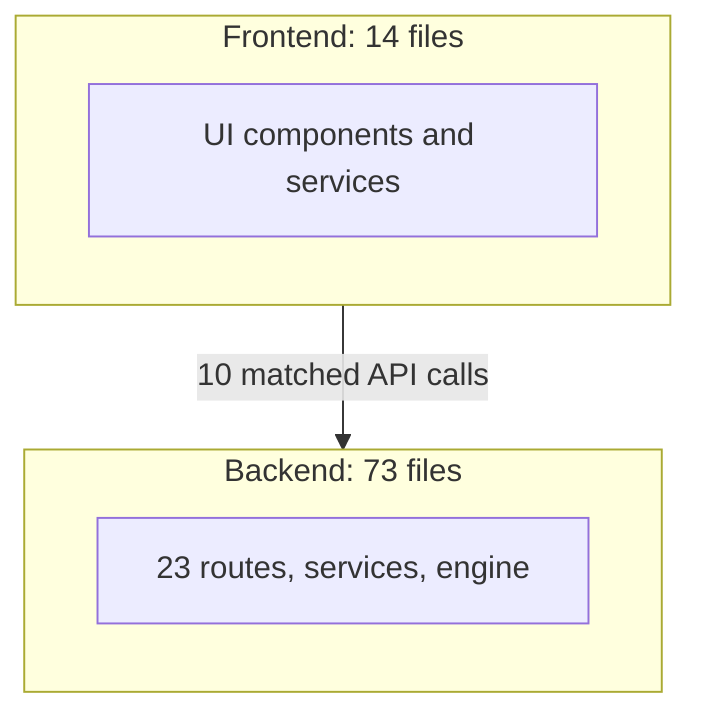

# Architecture Diagram (generated from the index)

Entry points: `client/index.html`, `client/index.tsx`, `server/run.py`, `server/app/main.py`, `server/utils/extract_docx_fast.py`

> Generated from deterministic facts. current_architecture.md adds the agent-verified detail.
