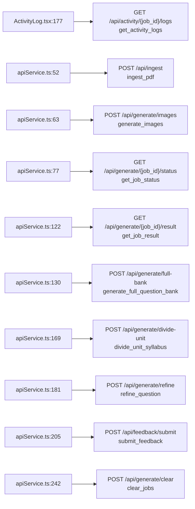
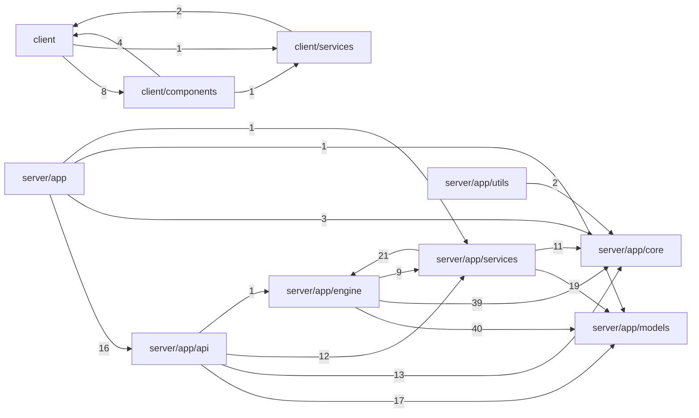

# Dependency and Relationship Map

## Frontend to backend (request flow)

| Frontend call | Backend route | Handler | Evidence |
|---|---|---|---|
| GET `/activity/{}/logs` | `/api/activity/{job_id}/logs` | get_activity_logs | client/components/ActivityLog.tsx:177 |
| POST `/api/ingest` | `/api/ingest` | ingest_pdf | client/services/apiService.ts:52 |
| POST `/api/generate/images` | `/api/generate/images` | generate_images | client/services/apiService.ts:63 |
| GET `/api/generate/{}/status` | `/api/generate/{job_id}/status` | get_job_status | client/services/apiService.ts:77 |
| GET `/api/generate/{}/result` | `/api/generate/{job_id}/result` | get_job_result | client/services/apiService.ts:122 |
| POST `/api/generate/full-bank` | `/api/generate/full-bank` | generate_full_question_bank | client/services/apiService.ts:130 |
| POST `/api/generate/divide-unit` | `/api/generate/divide-unit` | divide_unit_syllabus | client/services/apiService.ts:169 |
| POST `/api/generate/refine` | `/api/generate/refine` | refine_question | client/services/apiService.ts:181 |
| POST `/api/feedback/submit` | `/api/feedback/submit` | submit_feedback | client/services/apiService.ts:205 |
| POST `/api/generate/clear` | `/api/generate/clear` | clear_jobs | client/services/apiService.ts:242 |

## Module dependencies (resolved project-internal imports)

## Circular dependencies

None found among resolved imports.

## Database objects found in files

None. The application may use a schemaless store or an external database; see database.md.

> Import and call links are name-based and heuristic. Verified claims about them are in the layer documents with citations.
